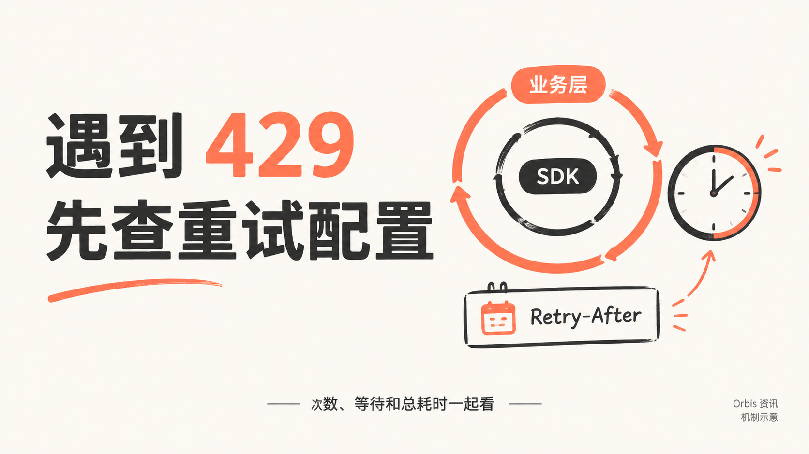

# API 429 越重试越严重？检查 SDK 重试、Retry-After 和总预算

API 返回 429 后，马上再发一次；仍然失败，就把重试次数调高。多个任务都这样做，可能把短时限流拖成持续拥堵。

排查时，查一下 SDK 和业务层是否都开了重试。业务代码里只有一层循环，实际发出的请求也可能不止这些。

举个简化的假设：业务层最多发起 3 次尝试，每次 SDK 又最多发起 3 次 HTTP 尝试。如果两层都持续触发，一个任务最多可能发出 9 次请求。这里的“尝试”包含首次请求，是机制说明，不是某次线上故障的记录。

## 先把重复的重试收拢。

查清 SDK、业务层和任务队列分别配置了什么。让一层负责重试，并明确总尝试次数和整体耗时，通常比每层各自加次数更容易控制。外层需要保留重试时，也要把内层行为计入总预算。

## 再区分哪些失败值得等。

临时限流可以考虑稍后重试。参数、认证、权限错误，以及明确的余额或长期配额问题，应先处理原因。超时后如果任务可能已经开始执行，还要先查询状态，避免重复提交。

## 有服务端等待提示时，按提示处理。

`Retry-After` 可能是等待秒数，也可能是一个 HTTP 日期。收到有效值后，应至少等到指定时间；如果已经超过当前任务允许的等待时间，可以结束本次处理或交回队列，不能为了满足自己的等待上限而提前重发。

没有有效提示时，再考虑有上限的指数退避：连续失败后逐步延长等待，同时加入随机抖动，让不同任务不要总在同一时刻重新请求。具体参数要按服务限制和业务等待时间设置，不能把一组固定秒数当作所有接口的标准答案。

重试之外，新任务的发送速度也要控制。后台仍在持续灌入请求时，单独修改重试间隔可能不够。队列释放速率、并发和 Token 用量，需要一起检查；退避不会提高服务本身的容量。

## “重试三次”到底包含几次首次请求？

配置前先明确术语。如果“最大尝试次数”为 3，通常表示首次请求加最多两次重试；如果配置项写的是“额外重试次数”，数值 3 则可能表示最多四次尝试。具体含义必须查当前 SDK 的文档，不能只看变量名猜。

| 位置 | 应核对的配置 | 容易遗漏的影响 |
| --- | --- | --- |
| SDK | 自动重试次数、可重试错误、单次超时 | 一次业务调用内部可能已有多次 HTTP 请求 |
| 业务层 | 最大尝试次数、整体截止时间 | 与 SDK 的次数相乘，而不是简单相加 |
| 任务队列 | 失败后重新投递、重复消费 | 请求结束后还可能再次启动同一任务 |
| 服务端 | Retry-After、任务查询、幂等能力 | 等待提示和已创建任务需要单独处理 |

`Retry-After` 的两种格式可以分别理解：`120` 表示等待秒数，`Wed, 21 Oct 2015 07:28:00 GMT` 展示 HTTP 日期的格式。后者是格式示例，实际处理要根据当前收到的值计算等待时间。若提示要求等待的时间超出任务预算，应停止或交回队列。

图片、视频等异步生成任务尤其要分清“提交失败”和“没有收到提交结果”。超时并不能证明服务端没有创建任务；应按该接口的任务查询和幂等规则处理。`Idempotency-Key` 也只有在服务明确支持且遵守其使用规则时，才提供相应去重语义。

## 延伸阅读

Orbis 资讯的[429 限流与重试指南](https://orbiorbi.com/news/ai-api-429-paizhang/?utm_source=github&utm_medium=post&utm_campaign=news_20261019&utm_content=n04_retry)提供了含 `Retry-After` 处理、指数退避和随机抖动的 Python 示例，适用于 OpenAI 兼容的 Chat Completions 接口。对照代码时，还要检查自己的 SDK 配置、任务是否允许重复执行，以及整体耗时预算；其他协议需相应调整。

本文由 Orbis 整理，围绕已有指南拆解使用方法与排查思路。文中的提示词和次数计算用于说明结构或机制，不作为模型效果或线上事故实测。
